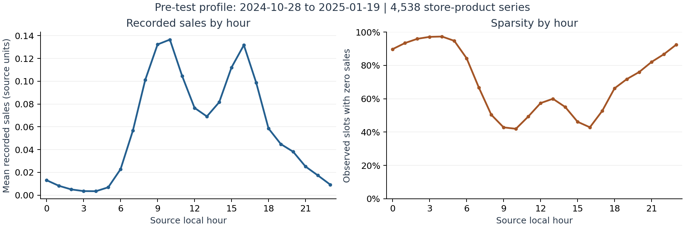

# FreshRetailNet-LT as an Intermittent Recorded-Sales Forecasting Benchmark

Protocol **frn-intermittent-v2** · Local research draft · November 25, 2026

## Abstract

We define a reproducible benchmark of recorded retail sales using FreshRetailNet-LT. The comparison covers eight released foundation models, fitted neural and statistical methods, three quantile LightGBM strategies, supplied Sporacast, and the requested DWABI combination. It measures next-day hourly and next-week daily forecasts on a continuous six-month test period. A mature training cohort and a year of fitting history at both resolutions give trained comparators a substantial historical prefix. RMSSE and a finite-decile approximation to CRPS measure different aspects of accuracy. Training-only intermittency and zero-proportion filters expose differences across sales patterns without choosing features or recipes from test performance. This version documents the frozen design, preparation audit and verification. Revised-protocol model results are added only after complete forecast and independent score replay. The task concerns recorded sales and does not identify latent demand lost during stockouts.

## 1. Scope and scientific position

The objective is to populate a transparent benchmark with straightforward participants. It is not to establish that reconstruction improves forecasts, optimize a winning recipe, or study which input features help. Accordingly, there are no recovery methods, feature-profile comparisons, external hyperparameter searches, custom synthetic pretraining programmes, or cross-model blends beyond the explicitly requested DWABI participant.

FreshRetailNet-LT contains real retail observations. Zeros and stockout sales remain observations in this task. A released model trained on synthetic data is a model-provenance question, distinct from the provenance of this evaluation dataset.

The original FreshRetailNet-LT leaderboard evaluates a different forecasting target population, mask and metric collection. Its protocol remains available separately for historical comparability; scores from the two protocols must not share a ranking.

## 2. Dataset and canonical preparation

We use Dingdong Inc.'s FreshRetailNet-LT revision 8a9543bee53de0e2edc90881c2bbd2bfb711cc51, under CC BY 4.0. The source calendar extends from June 5, 2023 through July 20, 2025: 777 calendar days. The official 10,000 store–product universe anchors the audit.

Canonical arrays preserve identifier strings, source local day/hour boundaries, original sales, stock status, daily covariates, metadata and observation presence separately. We do not convert the source dates using the workstation's timezone. The supplied daily and hourly sales use a common global normalization coefficient; the measurements and unscaled probability score are therefore in published normalized-sales units, not item counts or currency.

Three states remain distinct:

- An in-source zero is an observed zero.
- Sales recorded during a stockout remain observed recorded sales.
- An absent source record is unknown and never becomes a zero evaluation label.

A daily target sums all 24 hourly sales. The audit verifies hourly/daily reconciliation and validates source lengths, duplicate keys, numeric values, status codes and gaps. No weekly, monthly or shift target belongs to this simplified campaign. A seven-day horizon is seven daily targets, not a weekly aggregate.

The frozen preparation report is reports/intermittent-v2/data-audit.json. It binds the source receipt, canonical arrays, protocol, cohort, origin eligibility and profiling artifacts by SHA-256.

**Figure 1.** The 84 days before testing, October 28, 2024–January 19, 2025, across all 4,538 core series. Each point pools original observed slots; absent measurements are excluded and stockout sales retained. Zero proportions vary strongly within the day, and recorded sales also occur outside the daytime peaks. These descriptive weights differ from the equal-series forecast-score weights. The [saved analysis receipt](figures/training-hour-profile.json) supplies counts, sums and source/figure hashes; its totals exactly match the frozen profiling artifact.

## 3. Test span, cohort and training fairness

### 3.1 Why six months

The earlier eight-week pilot had only eight weekly forecast origins. The revised continuous test spans January 20–July 20, 2025, giving 26 weekly occasions and 182 daily occasions.

This leaves 595 calendar days before the first test issue. A 52-week test starting July 22, 2024 would leave 413 days. Both alternatives permit a 365-day fitting window. Under the same pre-test maturity rules, the 52-week alternative supports 3,576 parents across 809 stores, while the six-month design supports 4,538 across 838 stores. We chose six months to retain this larger established-series training and evaluation panel and a longer pre-test prefix for non-foundation methods. These counts come from the frozen history-support audit, `reports/intermittent/test-span-qualified-support-20261125.json`, recorded before v2 model comparison. We do not treat six months as evidence of full annual generalization.

The decision used training-history and coverage audits before comparing v2 candidate scores. The earlier v1 scores were already known; this remains a retrospective, public-data study rather than a blind or prospectively registered experiment. No v1 result is relabelled as v2, and May-selected v1 hyperparameters cannot be used for earlier January v2 issuance.

### 3.2 Fixed mature core and prefix eligibility

The canonical parent universe is the official July 14–20, 2025 evaluation roster. Within that universe, a parent needs at least 365 originally observed daily records before January 20, including 300 in the preceding 365 days, 42 in the preceding 84 days, one in the preceding seven days, and positive supported hourly and daily training scales. These rules freeze **4,538 store–product parents across 838 stores**.

At each forecast origin, a member must still have at least one original record in the preceding seven completed days and a valid task scale. The core remains fixed; required origin populations can vary. Conditional on the July roster, activity, scales and issue-time features use causal prefixes. An observed zero satisfies the activity check. The overall parent universe depends on July membership, so the complete cohort is retrospective.

The benchmark estimates performance on established members of the official evaluation roster. A bounded audit of stores 0–9 found 26 of 95 qualifying parents outside that roster using complete-day lag-seven pairs as a sufficient test for a positive hourly scale. This example establishes roster dependence and covers only those stores. A year of historical opportunity also does not make training compute or architecture identical across methods.

| Task | Issue schedule | Horizon | Origins | Inference context | Required / observed targets |
|---|---|---|---:|---|---:|
| Hourly H24 | Midnight daily, January 20–July 20 | Next 24 hours | 182 | 168 hours | 19,783,176 / 19,768,080 |
| Daily H7 | Midnight Mondays, January 20–July 14 | Next seven days | 26 | 84 days | 824,047 / 823,276 |

Every method must provide the complete required origin-specific grid, including forecasts whose future source target is unknown. Unknown labels are omitted by the evaluator, never by a model's forecast contract. Missing model forecasts invalidate the task result.

### 3.3 Training and validation

All fitted participants use the preceding **365 calendar days at both resolutions**. Models with separate neural input tensors use 168 hours or 84 days at issuance. AutoMFLES and Sporacast instead retain their native 365-day historical state, disclosed in method details. Neural and tree comparators refit weekly; the two native statistical APIs refit parameters at each issue. Native automatic selection finishes before January 20. New observations can enter a later fit once available. They cannot select a different recipe using benchmark scores.

AutoNBEATSx, AutoNHITS and AutoTFT use January 13–19 for native pre-test validation, followed by the selected full-prefix fit. AutoMLForecast selection ends before January 6. Its daily residual backcasts are issued January 7, 8, 9 and 10; hourly backcasts January 15, 16, 17 and 18. Every correction label matures before testing.

Training and validation scores are implementation/selection evidence, not leaderboard rows. There is no separate seasonal evaluation or grand cross-frequency score.

## 4. Covariates and information availability

Every participant receives all inputs its released interface supports. There is one information policy: sales, calendar/holidays, assumed planned discount, historical realized covariates, and prefix-known static hierarchy. Unsupported inputs are disclosed instead of silently credited.

| Source variable | Hourly representation | Daily representation | Forecast-time permission |
|---|---|---|---|
| Sales | Original measurement | Sum of all 24 hours | Completed intervals only |
| Discount | Daily ratio repeated within its day | Original daily ratio | Assumed known future |
| Calendar | Hour, weekday and annual cyclic features | Weekday and annual cyclic features | Known future |
| Holiday | Daily flag repeated within day | Original daily flag | Known future |
| Precipitation | Last released daily summary | Completed daily summary | Past only |
| Temperature, humidity, wind | Last released daily summary | Completed daily summaries | Past only |
| Activity | Last released realized daily value | Completed daily value | Past only |
| Stock | Original completed hourly annotation | Stockout fraction over 24 known hours | Past only |
| Store/product/city/category hierarchy | Prefix-known native categories or numeric channels | Same rule | Prefix-known |

Repeating a daily summary does not manufacture hourly weather measurements. Repeated precipitation, discount or flags are not summed when obtaining a daily value. The source already supplies daily covariates, so no arbitrary sales-weighted weather or future-sales-weighted price aggregation is introduced.

A daily realized measurement becomes available after its source day ends. Historical hourly slots before 23:00 use the preceding completed daily summary; the final 23:00–24:00 slot can carry the now-completed day. Daily historical slots use completed-day summaries. Direct supervised examples align past-only inputs to their own issuance. Recursive rollouts hold past-only covariates at the issue. Realized future weather, activity and stock status are excluded. No archived weather forecasts are supplied.

The dataset has a discount ratio rather than a separate nominal selling-price field. Under the retailer-known-price assumption, we freeze a plan made solely from that discount channel: retain finite values including zero, carry earlier planned values over archive gaps, use an undiscounted ratio of one before the first value, and set plan availability to one everywhere. This prevents future source-row presence from becoming a known-future feature. Adapters accepting known-future covariates use this feed on future grids and internal validation grids. Toto2's historical-only interface does not receive future covariates.

This is a retrospective assumed schedule, not an independently archived issue-time plan. That limitation is retained rather than creating a second price-information experiment.

For interfaces needing numeric static inputs, seven hierarchy fields receive original-sales group means computed strictly before January 1, 2024, with a corresponding early global fallback. Hourly means divide daily means by 24. Native category/grouping interfaces are used where available. Normalizers can remove constant channel levels; supplied static channels do not establish effective level conditioning.

Input permissions are shared; feature matrices follow each method's native interface. Foundation inputs contain sales and covariate sequences, without additional engineered lag or rolling-statistic columns; numeric static means are supplied as constant channels. LightGBM uses explicit sales lags/rolling means, repeats the latest released past-only covariates across its forecast horizon, and uses the completed discount plan in historical feature frames. Foundation histories retain archived discount values with missingness flags. These implementation differences belong to the declared native recipes.

Models accepting missing targets retain native masks. Dense-input comparators complete only source gaps with prior same-season observed means, then prior overall means. Leading unknowns use a zero placeholder plus unavailability mask. Only original observations enter donor pools. Recorded zeros and stockout sales are never replaced. Filled values are not evaluator truth.

## 5. Metrics and aggregation

Let i identify a parent series, o a forecast origin and V_io the available future labels. Define a training scale from original recorded sales in the preceding 365 days:

$$
b_{io}=\frac{1}{|P_{io}|}\sum_{t\in P_{io}}(Y_{it}-Y_{i,t-m})^2,
$$

where m is seven calendar days, matching the hour for hourly forecasts. Both observations must lie in the training window. At least 14 valid difference pairs and a positive scale are required. There is no arbitrary epsilon, count floor, reconstructed-history scale or per-model eligibility.

The point score is root mean squared scaled error within each parent–origin case:

$$
R_{io}=\sqrt{\frac{1}{|V_{io}|}\sum_{h\in V_{io}}\frac{(Y_{ioh}-\widehat Y_{ioh})^2}{b_{io}}}.
$$

The probability score uses Q={0.1,0.2,...,0.9} and pinball loss rho_q(u)=u(q−1[u<0]):

$$
C_{io}=\frac{1}{|V_{io}|}\sum_{h\in V_{io}}\frac{2}{9}\sum_{q\in Q}\rho_q(Y_{ioh}-\widehat Y^{(q)}_{ioh}).
$$

We call this **CRPS-9**, a finite-decile approximation to CRPS. It is neither exact full-distribution CRPS nor training-scaled CRPS. It remains in globally normalized sales units and is more sensitive to sales level than RMSSE.

For either score, average scoreable parents equally within an origin and origins equally:

$$
\overline L=\frac{1}{|O|}\sum_{o\in O}\frac{1}{|I_o|}\sum_{i\in I_o}L_{io}.
$$

The square root is taken before aggregating RMSSE cases. Missingness and prefix activity mean a parent's contribution across the entire panel need not be equal. Report support and origin-level results so this weighting remains visible.

The point action is declared as a native mean, median or other supplied estimate. Nine marginal quantiles are not averaged and called a mean. Point-only models receive no probability rank. Forecast adapters declare quantile sorting and nonnegative projection; the evaluator validates forecasts without repairing them.

RMSSE follows the supplied evaluation commentary's broad-comparison recommendation. CRPS-9 assesses the released quantile outputs without pretending to observe a full distribution. Additional original metrics belong only to the separate original-protocol view.

## 6. Training-only intermittency and sparsity

Profiles use observed original sales in the 84 days strictly before January 20. ADI is the number of observed intervals divided by positive intervals. CV² is the squared coefficient of variation of positive sales. ADI 1.32 and CV² 0.49 separate smooth, erratic, intermittent and lumpy profiles; all-zero and unobserved histories have explicit states.

Sparsity is the observed zero fraction. Missing measurements are excluded from its denominator. Intermittency and sparsity filters intersect these fixed groups and recompute the same macro score without refitting. Neither group membership nor thresholds use test sales. An empty intersection receives no score.

<!-- BEGIN PROFILE AUDIT -->

| Pre-test profile | Hourly | Daily |
|---|---:|---:|
| Observed zero share | 70.5370% | 2.7291% |
| smooth | 0 | 4,354 |
| erratic | 6 | 44 |
| intermittent | 3,631 | 98 |
| lumpy | 892 | 33 |
| all-zero | 9 | 9 |
| unobserved | 0 | 0 |

<!-- END PROFILE AUDIT -->

Hourly zeros include overnight structure. Calling them intermittent recorded sales does not imply an independent-arrival demand process or identify latent no-stockout demand. Daily aggregation changes sparsity, target definition and operational horizon; it is not just score normalization.

## 7. Participants and fixed budgets

| Participants | Declared native recipe and boundary |
|---|---|
| Chronos-2 | Released zero-shot weights; cross-learning disabled; native masked targets and supported covariates |
| TiRex 2 | Released weights and supported native covariates |
| TimesFM 3 | Released zero-shot weights, native masks and supported covariates |
| Toto 2 | Released 313M checkpoint; native joint historical auxiliary variates within parent; sales channel scored; no supplied-future-exogenous API |
| t0-gamma, t0-beta | One released checkpoint each, native target/past/future roles, independent parent attention; integer snapping disabled |
| Timestral-209M | Released Mistral checkpoint with native historical and known-future covariates |
| CIProto | Released checkpoint, complete eligible origin cohort and actual prefix hierarchy, native grouping/TTA, released bfloat16 autocast with float32 parameters |
| AutoNBEATSx, AutoNHITS, AutoTFT | Native NeuralForecast 3.3.1 Auto classes; exactly two pre-test trials, decile MQLoss, 1,000 updates, batch/windows 32 and frozen selected actual parameters |
| Crossformer | Authors' fixed width128/FF256/heads4/layers2/segment6, 1,000 updates, historical multivariate channels and point-only sales output |
| AutoMLForecast LightGBM direct/recursive/Rectify | MLForecast 1.1.0 and LightGBM 4.6.0; shared two-trial pre-test selection, native point plus nine quantile objectives |
| AutoMFLES | StatsForecast 2.1.1; two candidates, OLS exogenous fitting, fixed native conformal quantiles and frozen per-parent selection |
| Sporacast v2 | Supplied 0.2.0.dev0 native algorithm, pre-test selection and frozen-policy parameter updates |
| DWABI | Released 0.1.2 WalkForwardBlend, all eight admitted original foundation members and chronological native joint-pinball updates |

No AutoCrossformer exists in the pinned Nixtla release. Crossformer is therefore the fixed authors' method, with no future-exogenous argument. AutoNBEATSx replaces univariate N-BEATS for the requested covariate comparison.

MLForecast 1.1.0 has no public named Rectify API. The local declared implementation combines issued recursive backcasts with direct residual corrections, following the hybrid strategy rather than claiming a nonexistent native function. Direct row budgets are at most 32,000 original labels per lead; recursive budgets at most 32,000×H. Quantile-recursive feedback is a plug-in path approximation, not joint predictive sampling.

AutoMFLES uses max_rounds8/16, no changepoints, OLS exogenous fitting and seasons7 daily/[24,168] hourly. Native two-window conformal intervals yield deciles around its native centre. Per-series constant static effects are not separately identifiable in that exogenous regression.

Foundation execution uses each pinned native CUDA recipe, with TF32 disabled and effective torch kernel files pinned. The float32 recipes are retained for the other foundation participants; CIProto uses the released autocast configuration described below. Earlier paired CPU/CUDA diagnostics retained five strict closeness failures: Chronos daily, TimesFM hourly, Timestral daily and both TiRex tasks. Released near-constant normalization or detrending amplified device-rounding differences. Those diagnostics remain available. Native normalizers and covariates are preserved, and same-device batch/group checks remain required.

CIProto uses the released `mamba3` CUDA backend with bfloat16 autocast and float32 parameters, following the original TTA file (SHA-256 prefix `970c4bf1`). This execution recipe was selected from the released configuration and resource qualification before comparing its complete benchmark scores. Its separate NVCC 13.3.33 compiler resolves the observed host-header incompatibility; the installed Python toolkit remains 13.0.3.0 and Torch's CUDA build remains 12.8. Four-parent native checks observed all 16 cells and verified ordering invariance. Both daily and hourly two-issue qualifications then used the full 4,538-parent input cohort, preserving input identities and validating complete native shapes, exact requested keys, finite/nonnegative/ordered outputs, sealed payloads, resource headroom and unchanged fresh-process reads. Their resource receipts are `task-1-resource-daily-7.json` (SHA-256 prefix `1e3e7f13`) and `task-1-resource-hourly-24.json` (`75dc0804`), under `.superpowers/sdd/2026-11-26-ciproto-native-gpu-default`.

The earlier FP32-specific CIProto daily run and its dependent DWABI result are preserved with their original source snapshots in `runs/retired-attempts/20261126-ciproto-released-gpu-default`. The current daily CIProto result was recomputed across all 26 origins with the released GPU configuration, and DWABI is recomputed from that member forecast. Retirement and independent preservation receipts retain all 115 original files and canonical ownership anchors. A historical portable-backend diagnostic from the earlier FP32 path found three of 252 decile differences beyond its unchanged tolerance (maximum absolute difference 0.0004501343); all 28 point forecasts met it. This remains a diagnostic of that earlier recipe. Current compiler, mapped-runtime, precision and emitted-kernel evidence belong to the current native gates and per-origin receipts.

TimeH2O-v1 is excluded because its pinned official training disclosure names FreshRetailNet-LT. The eight admitted foundation participants remain pretraining-unverified where corpus disclosure is incomplete. Zero-shot use in this experiment does not establish absence of training overlap. A synthetic-only claim also requires reproducible generation details; none is inferred from a model name.

### 7.1 DWABI chronology

DWABI alone is the authorized cross-model combination. Its candidate roster is all eight admitted foundation methods, using original keyed forecasts with complete deciles and matching member hashes. Each member retains its independent leaderboard row.

Use native joint-pinball selection and weights, weighted=True, lookback=None and full_roster=True. Until three earlier windows mature, the released cold start uses equal full-roster weights. There are no extra warmup model fits or chosen policies. Later native subset selection does not change the declared candidate pool.

At a shared midnight, availability precedes issuance through explicit two-phase integer clocks. Only fully mature earlier forecast windows can enter the decision. Original finite outcomes are used with per-parent lead weights; unknown outcomes never become zero and scale eligibility does not redefine the native truth. Save member hashes, weights, decisions and mature-window clocks at every origin.

### 7.2 Requested Sporacast forecast-feature extension

The user subsequently requested one additional fitted participant using CIProto and t0-gamma zero-shot forecasts as predictors. The original Sporacast comparator is retained. This extension is disclosed as post-results design work; it does not alter the frozen original participant manifest or the eight-member DWABI roster. Source-level contract checks and full-cohort two-issue warm/cold qualifications have passed for both resolutions. These establish execution capability and bounded pilot resource measurements; extension accuracy and complete-bank runtime remain unmeasured.

For the native Sporacast row indexed by historical tick t and one-based lead h, with step length Δ, define issue s=tick[t]+Δ and target interval [tick[t+h],tick[t+h]+Δ). Append each foundation source's native point and nine labelled deciles, all from that same parent, issue and lead. The twenty predictors augment the native feature matrix. Every quantile learner retains its own alpha and actual-sales training outcome; forecasts are not substituted as labels.

Two availability clocks matter. A foundation forecast is immediately usable at s, without observing its future actual. A supervised row can enter a fit only once its actual target interval has ended by that fit's cutoff. Historical training features must therefore be generated at their own logical issues from their own available prefixes, including hourly intraday issues. Computing them later in wall-clock time does not authorize later information. Forecasting at a validation or test issue uses the newly issued foundation outputs immediately.

The extension reuses the supplied stride-one windows, native sample coordinates, weights, row budgets, validation and parameter-update schedule. Feature planning enumerates the union actually needed by those stages. Foundation inference uses a fixed full cohort per issue, rather than a cohort selected by later training labels. Exact keyed banks preserve source, checkpoint, inputs, decile identity and native runtime provenance; missing keys cannot become zeros, nearest-origin values or reduced scoring support. Actual-sales labels remain separate from these banks. End-to-end cost includes historical foundation generation, verification, storage and Sporacast fitting, rather than treating lookup latency as complete computation.

## 8. Measured revised-protocol results

Only completed v2 tasks enter these tables. Native small checks, partial origins and v1 pilot results do not receive scores here.

<!-- BEGIN MEASURED RESULTS -->

Snapshot 2026-11-26T08:23:49.391352+00:00: **35 of 38** complete v2 participant/task results.

### Hourly H24

| Method | RMSSE | CRPS-9 |
|---|---:|---:|
| AutoMLForecast LightGBM · recursive | 0.669981 | 0.043321 |
| AutoMLForecast LightGBM · direct | 0.675541 | 0.041760 |
| AutoMLForecast LightGBM · Rectify | 0.684015 | 0.041140 |
| Crossformer | 0.685289 | — (point only) |
| AutoTFT | 0.709868 | 0.041905 |
| Sporacast v2 | 0.716696 | 0.041193 |
| TimesFM 3 | 0.718592 | 0.043021 |
| Chronos-2 | 0.731632 | 0.042860 |
| DWABI · all admitted foundation members | 0.735202 | 0.042159 |
| t0-gamma | 0.736956 | 0.042360 |
| t0-beta | 0.737560 | 0.042739 |
| CIProto | 0.738961 | 0.042442 |
| Timestral-209M | 0.741376 | 0.042475 |
| Toto 2 · historical covariates | 0.748710 | 0.043211 |
| TiRex 2 | 0.752685 | 0.044376 |
| AutoNBEATSx | 0.782799 | 0.052359 |
| AutoNHITS | 0.785052 | 0.052331 |

Unscored participants for this task are AutoMFLES, Sporacast v2 · CIProto + t0-gamma features.

### Daily H7

| Method | RMSSE | CRPS-9 |
|---|---:|---:|
| AutoMLForecast LightGBM · recursive | 0.669059 | 0.343087 |
| Sporacast v2 | 0.673156 | 0.337193 |
| AutoMLForecast LightGBM · Rectify | 0.673921 | 0.343745 |
| AutoMLForecast LightGBM · direct | 0.678162 | 0.340604 |
| AutoTFT | 0.681592 | 0.345150 |
| DWABI · all admitted foundation members | 0.694323 | 0.344816 |
| CIProto | 0.694572 | 0.344744 |
| TimesFM 3 | 0.698149 | 0.347411 |
| t0-gamma | 0.699096 | 0.347809 |
| t0-beta | 0.699302 | 0.347516 |
| Timestral-209M | 0.702807 | 0.350908 |
| Chronos-2 | 0.711898 | 0.355070 |
| TiRex 2 | 0.713033 | 0.354881 |
| Toto 2 · historical covariates | 0.717217 | 0.357075 |
| AutoNBEATSx | 0.738269 | 0.372320 |
| AutoMFLES | 0.811412 | 0.439101 |
| Crossformer | 0.811416 | — (point only) |
| AutoNHITS | 0.932252 | 0.494076 |

Unscored participants for this task are Sporacast v2 · CIProto + t0-gamma features.

<!-- END MEASURED RESULTS -->

The v1 pilot's seven applicable daily results remain in the immutable earlier registry. They are evidence from a different calendar, cohort and selected recipes, not the current six-month ranking.

## 9. Relationship to the original FreshRetailNet-LT evaluation

The original daily leaderboard uses July 14–20, 2025, 10,000 series, 70,000 required predictions, a 35,785-row psd>=0 and stock_hour6_22_cnt==0 scoring mask, and pooled WAPE, signed WPE, MAE and MSE. Its permitted information can include realized future weather under its own rules.

Our recorded-sales task instead keeps observed stockout sales, removes unknown targets only, uses a mature prefix-qualified population, extends evaluation origins, requires an explicit assumed discount plan and past-only realized weather, and reports macro RMSSE/CRPS-9. These are different questions; a lower score in this framework is not evidence of beating the original leaderboard.

The separate footer view preserves the original protocol. Exact scorer reproduction and reproduction of a trained baseline remain distinct claims.

## 10. Reproducibility and result admission

Preparation, run specifications, source/checkpoint/licence/runtime hashes, original forecast files, per-origin receipts, point/probability interpretations and training/selection lineage are retained. V2 forecasts use a separate namespace and registry. Foundation CUDA receipts pin the effective torch kernel files. AutoMFLES records selected native CPU libraries including NumPy/SciPy linear algebra, and LightGBM and Sporacast record selected native CPU libraries. Auto neural and Crossformer bind implementation source, package versions and interpreter without native kernel file hashes. Each result lists its recorded pin level.

Complete tasks undergo canonical scoring and a genuinely separate saved-output implementation of RMSSE/CRPS-9 and aggregation before atomic registry admission. A sealed run with missing or changed evidence fails; it is not permission to overwrite forecasts. Small native checks and partial jobs are never registered.

Core preparation and arithmetic checks include calendar keys, variable origin populations, zero/stockout/unknown states, within-case roots, quantile-loss direction, point-only capability, interrupted write recovery and provenance corruption. Native checks cover real source gaps, finite outputs, forecast alignment and batch/group invariance. Their scope is reported separately from full benchmark execution. The reviewed historical retained foundation forecasts were validated after projection. Their raw native outputs were not saved and the review found no observed native nonfinite. Future retained issuance checks the raw point and all scored deciles before projection.

Example WSL commands, from local-development-folder:

~~~bash
PYTHONPATH=src environments/chronos-copy/bin/python -B scripts/prepare_intermittent_v2.py
PYTHONPATH=src:scripts CUDA_VISIBLE_DEVICES=0 environments/chronos-copy/bin/python -B scripts/run_intermittent_v2_cuda.py --method chronos2 --task daily-7 --smoke
PYTHONPATH=src:scripts CUDA_VISIBLE_DEVICES=0 environments/chronos-copy/bin/python -B scripts/run_intermittent_v2_cuda.py --method chronos2 --task daily-7
PYTHONPATH=src:scripts CUDA_VISIBLE_DEVICES=0 environments/intermittent-ci-fused-20261125/bin/python -B scripts/run_intermittent_v2_cuda.py --method ciproto --task daily-7 --smoke
PYTHONPATH=src:scripts CUDA_VISIBLE_DEVICES=0 environments/intermittent-ci-fused-20261125/bin/python -B scripts/run_intermittent_v2_cuda.py --method ciproto --task daily-7
PYTHONPATH=src environments/chronos-copy/bin/python -B scripts/intermittent_v2_report.py
~~~

Use the separate pinned additions environment for t0/Timestral/DWABI, the isolated `intermittent-ci-fused-20261125` environment for native CIProto issuance, and the designated neural, tree/Sporacast and statistical environments for fitted participants. CIProto selects its prepared native GPU backend by default. These examples assume a fresh reproduction workspace with the pinned environments and references prepared. Preserve sealed historical runs and their source bundles; changed-source invocations cannot overwrite their namespaces. Numerical threads are bounded; only one GPU process owns admission. The handover identifies current processes and restart gates. No duplicate worker or mutation of an active numerical source is allowed.

The local React/TypeScript site exposes task, training intermittency, zero proportion, two sortable metrics, coverage and method provenance. There are no training/validation score tables, feature regimes or pilot rankings. Publication, external submissions, email and model redistribution remain deferred. TimesFM weight restrictions and other per-model licences are retained; no release package bundles restricted weights.

## 11. Limitations

Recorded sales are affected by natural stockouts. These scores do not identify latent demand, staffing cost, replenishment profit or the counterfactual no-stockout target. Structural overnight zeros strongly influence hourly profiles.

The mature cohort excludes younger or less complete series. Prefix activity can change the required population across origins. Six months cover more occasions than the pilot but not a full annual test cycle. Non-overlapping seven-day targets still share product/store histories and are not independent samples.

Public targets permit deliberate test fitting. Open experiment code, declared cutoffs, forecast receipts and replay improve auditability without guaranteeing its absence. Foundation pretraining overlap remains unverified without adequate data/generator disclosure.

Native point actions, supported covariates, normalization and probability formats differ. Marginal quantile sums are not used to fabricate aggregate quantiles. CRPS-9 uses finitely many quantiles and differs in level sensitivity from RMSSE. No grand rank combines repeated frequency views of one dataset.

Timings are local operational observations under concurrent workloads. The report records each timing basis and scope. Foundation timings sum the measured origin phase after model setup and before final scoring. AutoMFLES reports pre-test selection separately from the per-origin fit and issuance total. Sporacast reports native fit, update and prediction measurements separately. The three LightGBM strategy intervals overlap within one shared task process. Summing them double-counts that process, and strategy-level attribution is unavailable. The benchmark does not establish controlled efficiency differences.

## Appendix A. Worked evaluation examples

**Zero versus unknown.** A source value zero counts in training, the zero fraction and evaluation. An absent record contributes no label, although its forecast remains required.

**Root placement.** With unit training scales and one lead, errors0 and4 across two parents give mean-case RMSSE2. Errors2.1 and2.1 give2.1. Taking one root after pooling squared errors instead gives sqrt(8)=2.828 for the first method and reverses the ordering. This is why the within-case root is explicit.

**Probability loss.** An actual value2 and all deciles at1 give CRPS-9=2×mean(.1,...,.9)=1. At q=.9, underprediction by2 costs1.8; overprediction by2 costs.2.

**Origin weighting.** Scores1 and9 at one origin and3 at another aggregate to (5+3)/2=4, not13/3. Empty intersections receive no score.

**No future measurements.** A forecast issued at January20 midnight can use completed January19 measurements and assumed January20–26 discount/calendar values. Changing January20 realized weather or stock outcomes must not change those inputs.

**Forecast features before actuals.** At January20 00:00, an hourly lead3 forecast targets January20 02:00–03:00. Sporacast may consume it immediately at00:00. The corresponding actual sales can become a supervised label only at a fitting cutoff at or after03:00. A historical feature for that row always uses the00:00 foundation issue, even when the later fit also knows more recent sales.

These examples test arithmetic and information boundaries. They are not simulated training data or measured forecasting methods.

## References

- Dingdong Inc. [Pinned FreshRetailNet-LT dataset](https://huggingface.co/datasets/Dingdong-Inc/FreshRetailNet-LT/tree/8a9543bee53de0e2edc90881c2bbd2bfb711cc51) and [baseline code](https://github.com/Dingdong-Inc/frn-baseline).
- [Original executable leaderboard guide](https://huggingface.co/spaces/Dingdong-Inc/FreshRetailNet-LT-Leaderboard/blob/main/STATIC_GUIDE_CN.md), with retained source revision in the original-protocol evidence.
- Nixtla [MLForecast](https://github.com/Nixtla/mlforecast), installed1.1.0; [NeuralForecast](https://github.com/Nixtla/neuralforecast), installed3.3.1; [StatsForecast](https://github.com/Nixtla/statsforecast), installed2.1.1.
- [Crossformer authors' implementation](https://github.com/Thinklab-SJTU/Crossformer), source c10c8eadb153d1dd9798250967747ca3ebb81383.
- [Rectify: a hybrid strategy for multi-step-ahead forecasting](https://robjhyndman.com/publications/rectify/).
- [FEV evaluation framework](https://github.com/autogluon/fev), related explicit task/scorer design; no FEV aggregate rank is inherited.
- [Weighted interval score and probabilistic evaluation](https://journals.plos.org/ploscompbiol/article?id=10.1371/journal.pcbi.1008618), distinguishing finite quantile scores from full-distribution claims.
- Supplied methodological commentary, ref/paper-pdf/paper.pdf, retained privately and not redistributed.
- Supplied Sporacast0.2.0.dev0 source, frozen snapshot under ref/intermittent-benchmark-sources-20261121; F:/sporacast-v2 remains read-only.
- [t0-gamma](https://huggingface.co/theforecastingcompany/t0-gamma), [t0-beta](https://huggingface.co/theforecastingcompany/t0-beta), [Timestral-209M](https://huggingface.co/mistralai/Timestral-209M), [CIProto](https://huggingface.co/ContinuousIntelligence/ci-proto) and [DWABI](https://github.com/AbishekSriramulu/dwabi), with exact revisions and hashes in retained source bundles.
- [Excluded TimeH2O training disclosure](https://huggingface.co/h2oai/timeh2o-v1/blob/1310be782553943a4c520d2810a98ce8f56b2709/README.md).
